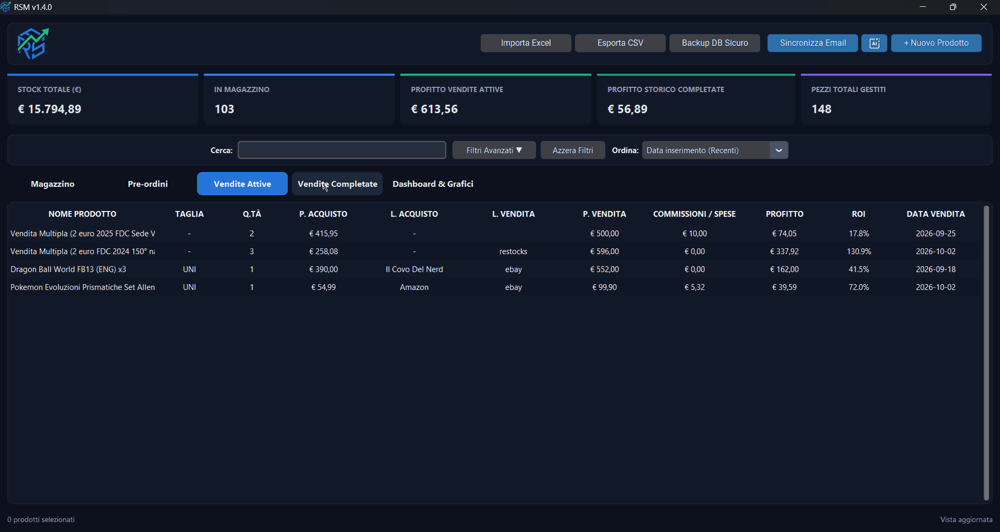

<div align="center">


# RSM

High-performance, modern desktop application (**Tauri + Rust & Python**) for managing inventory, pre-orders, active and historical sales, featuring a real-time KPI dashboard, interactive statistical charts, automated email synchronization, real-time shipment tracking (17TRACK), and intelligent AI-powered ingestion (text & voice).

<p align="center">
  <a href="./README.md"></a>
  <a href="./README.en.md"></a>
</p>

<!-- Badges -->
<p align="center">
  <a href="https://leorusso34.github.io/RSM/"></a>
  
  
  
  
  
  
  
  
  
  
</p>

<p align="center">
  <strong>Official Website & Live Showcase:</strong> <a href="https://leorusso34.github.io/RSM/">https://leorusso34.github.io/RSM/</a>
</p>

<p align="center">
  
</p>

</div>

---

## Key Features

- **📦 Inventory & Pre-orders**: Comprehensive tracking of products, sizes, quantities, purchase channels with fast-scrolling quick-picker dropdown, and release dates.
- **🏷️ Sales Management & Bulk Sales**: Rapid sale conversion, support for single or bundle/bulk sales, and intuitive drag & drop between tabs.
- **✅ Completed Sales History**: Permanent archival of finalized sales with exact calculations of gross revenue, marketplace fees, net profit, and real ROI.
- **🚚 17TRACK Shipment Monitoring**: Real-time shipment tracking integrated into the product detail Side-Drawer, carrier auto-detection (BRT, InPost Italy, Poste/SDA, GLS Italy, UPS, DHL), compact timeline view of latest checkpoints, expandable history drawer, and synchronized status with visual badges.
- **📦 Packlink PRO Shipment Draft Creation**: Automated draft generation on Packlink PRO via REST API v1, recipient details auto-completion powered by Google Gemini AI (`Quick Paste`), parcel presets (shoes, envelope, custom), and custom API key configuration.
- **📊 Interactive Dashboard & Analytics**: Real-time KPI summary metrics, monthly profit trends (€), top profitable products ranking, and sales volume breakdown by marketplace platform.
- **📬 Order Email Synchronization (Gmail + Gemini AI)**: Automated scanning of order confirmation emails from Gmail via IMAP and instant ingestion into Pre-orders powered by artificial intelligence.
- **🔍 eBay Market Price Estimation**: Automated lookup and visual display of average and recent sold prices on eBay via official APIs.
- **✨ AI Assistant with Voice Recognition**: Fast, structured product data extraction via Google Gemini (3.1 Flash Lite) and voice transcription supporting Italian and English speech recognition.
- **🔄 Built-in Auto-Updater**: Automatic checking for new releases on GitHub Releases with seamless download and assisted installation via a secure Cloudflare proxy.
- **🔑 Flexible Configuration via `config.json`**: Option to set personal credentials directly in the root `config.json` configuration file (with absolute precedence over in-app stored settings).
- **📁 Import / Export & Backup**:
  - Automated import from **Excel** spreadsheets (`.xlsx`).
  - Instant and secure backup of the local SQLite database.
- **⚡ Zero-Lag Architecture & Flat-Minimal Dark Theme**: Ultra-responsive native desktop interface built with Tauri (Rust + WebView2), 28px frameless custom titlebar, flush collapsible side-drawer, high-contrast flat-minimal dark theme, smooth 60 FPS animations, High-DPI display support, and zero-latency instant navigation.

---

## Credentials Configuration (`config.json`)

All external integrations (eBay market prices, 17TRACK shipment tracking, Google Gemini for quick AI entry and Excel import, and GitHub Releases update downloads) are managed and secured directly in the cloud through a **Cloudflare Worker**.

In the root `config.json` file, you can configure your personal credentials for email synchronization and logistics:

```json
{
  "email_sync_address": "your_address@gmail.com",
  "email_sync_app_password": "abcd efgh ijkl mnop",
  "packlink_api_key": "your_packlink_pro_api_key"
}
```

### Parameter Details:
* **`email_sync_address`**: Your Gmail address from which order confirmation emails are scanned.
* **`email_sync_app_password`**: 16-character Google App Password generated from your Google Account (Security $\rightarrow$ 2-Step Verification $\rightarrow$ App Passwords).
* **`packlink_api_key`**: Personal API key generated on Packlink PRO (Settings $\rightarrow$ Packlink PRO API Key) for automated shipment draft creation.

> **Note**: Values specified in `config.json` take **absolute precedence** over any data stored in the local SQLite database. If you modify credentials within the application UI (via configuration dialogs), `config.json` will also be automatically synchronized.

---

## Requirements and Development Setup

```powershell
# 1. Clone the repository
git clone https://github.com/leorusso34/RSM.git
cd RSM

# 2. Install dependencies
python -m pip install -r requirements.txt

# 3. Launch the application
python rsm.py
```

---

## Running Tests and Quality Assurance

The project integrates a comprehensive test suite powered by **Pytest**, automated **End-to-End (E2E)** testing with headless Chromium, and automated linting/formatting verification via **Ruff** (also enforced in GitHub Actions CI):

```powershell
# Install project dependencies
python -m pip install -r requirements.txt

# Run unit and integration tests (149 tests)
pytest -v

# Run the cascading E2E test suite (with video player recording and diagnostic reports on Desktop)
playwright install chromium
python tests/e2e/runner.py

# Run the code linter
ruff check .
```

---

## Standalone Executable Compilation

To compile and package the application into a standalone distribution (Zero-Lag Engine with Tauri and Rust):

```powershell
python build.py
```

The complete, ready-to-use standalone executable package will be generated in the `dist/RSM/` directory.

---

## Project Structure

```text
RUSSO STOCK/
├── assets/                       # Icons, branding, graphics, and showcase preview GIFs
├── docs/                         # Official showcase website (GitHub Pages)
├── src/                          # Modular Python backend
│   ├── ai_agent.py               # Google Gemini API integration
│   ├── config.py                 # Configuration constants and filesystem paths
│   ├── database.py               # SQLite database, queries, and schema migrations
│   ├── ebay_api.py               # eBay API client for sold market price estimation
│   ├── email_sync.py             # Gmail order confirmation sync via IMAP
│   ├── packlink.py               # Packlink PRO shipment draft creation via REST API
│   ├── speech_helper.py          # Voice recognition (bilingual IT/EN)
│   ├── tracking.py               # 17TRACK shipment tracking client via Cloudflare Worker
│   ├── types.py                  # Type annotations and data models
│   ├── updater.py                # GitHub Releases auto-updater and version checker
│   ├── utils.py                  # Financial math, currency formatting, Excel I/O
│   └── services/                 # Application runtime services
│       └── bridge_server.py      # High-performance local HTTP bridge server
├── src-tauri/                    # Native Rust Tauri core (windowing, IPC, and Zero-Lag)
├── web/                          # Modern Zero-Lag frontend (HTML5, Vanilla JS, CSS3)
│   ├── index.html                # Complete single-page user interface
│   ├── app.js                    # Reactive frontend application logic
│   └── styles.css                # High-contrast flat-minimal dark theme styling
├── tests/                        # Automated test suite (test_core, test_bridge, test_updater, test_tracking)
├── build.py                      # Packaging script and native Tauri standalone builder
├── config.json                   # External user credentials configuration
├── LICENSE                       # MIT Open Source License
├── README.md                     # Primary Italian documentation
├── README.en.md                  # Complete English documentation
├── requirements.txt              # Unified Python dependencies
└── rsm.py                        # Main application entry point
```

---

## License

Distributed under the [MIT](LICENSE) License.
