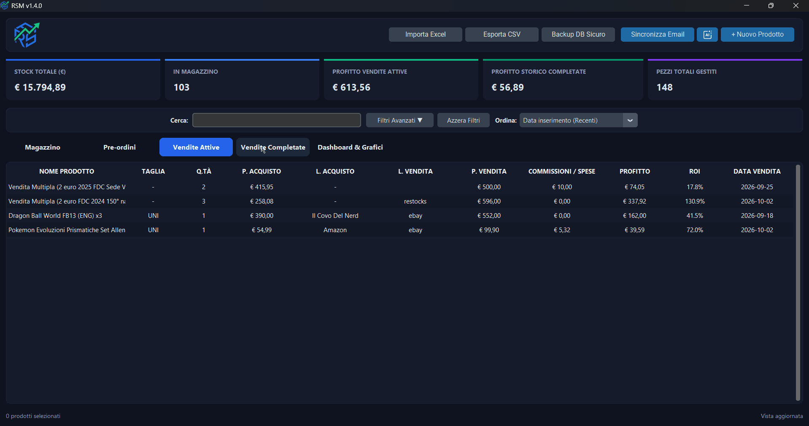

# RSM - Russo Stock Manager

Applicazione desktop moderna in **CustomTkinter** per la gestione di inventario, pre-ordini, vendite attive e storiche, con cruscotto KPI, grafici statistici interattivi, sincronizzazione email e inserimento intelligente con AI (testuale e vocale).

<p align="center">
  
</p>

---

## 🚀 Caratteristiche Principali

- **📦 Magazzino & Pre-ordini**: Tracciamento completo di prodotti, taglie, quantità, luoghi di acquisto con tendina a scorrimento rapido e date di rilascio.
- **🏷️ Gestione Vendite & Vendite Multiple**: Conversione rapida, supporto per vendite singole o in blocco (bundle) e drag & drop tra schede.
- **✅ Storico Vendite Completate**: Archiviazione permanente delle vendite concluse con calcolo esatto di ricavi, commissioni, profitto netto e ROI reale.
- **📊 Dashboard & Grafici Interattivi**: Indicatori KPI in tempo reale, andamento del profitto mensile (€), classifica top prodotti per utile e ripartizione vendite per piattaforma.
- **📬 Sincronizzazione Email Ordini (Gmail + Gemini AI)**: Scansione automatica delle conferme d'ordine da Gmail tramite IMAP e inserimento istantaneo nei Pre-ordini con intelligenza artificiale.
- **🔍 Stima Prezzi di Mercato eBay**: Ricerca automatica e visualizzazione dei prezzi medi e recenti di vendita su eBay tramite API ufficiali.
- **✨ Assistente AI con Riconoscimento Vocale**: Estrazione rapida e strutturata dei prodotti tramite Google Gemini (3.1 Flash Lite) e trascrizione vocale in italiano.
- **🔄 Auto-Updater Integrato**: Verifica automatica della disponibilità di nuove versioni su GitHub Releases con download e installazione assistita.
- **🔑 Configurazione Flessibile via `config.json`**: Possibilità di impostare API key e credenziali direttamente dal file esterno `config.json` nella cartella principale (con precedenza sui dati salvati in app).
- **📁 Import / Export & Backup**:
  - Importazione automatica da fogli **Excel** (`.xlsx`).
  - Esportazione **CSV** formattata per Excel italiano con intestazioni dettagliate.
  - Backup istantaneo e sicuro del database SQLite locale.
- **🎨 Interfaccia Dark Professionale**: Supporto nativo High-DPI su Windows, titlebar scura integrata, pill-navigation e finestre sempre perfettamente centrate.

---

## ⚙️ Configurazione Credenziali (`config.json`)

Nella cartella principale dell'applicazione puoi modificare o inserire direttamente i tuoi parametri nel file `config.json`:

```json
{
  "gemini_api_key": "LA_TUA_CHIAVE_API_GEMINI",
  "email_sync_address": "tuo_indirizzo@gmail.com",
  "email_sync_app_password": "abcd efgh ijkl mnop",
  "ebay_client_id": "TUO_EBAY_CLIENT_ID",
  "ebay_client_secret": "TUO_EBAY_CLIENT_SECRET",
  "github_token": "TUO_GITHUB_TOKEN_OPZIONALE"
}
```

### Dettaglio dei Parametri:
* **`gemini_api_key`**: Chiave API Google Gemini per l'assistente di inserimento prodotti e il parsing automatico delle email.
* **`email_sync_address`**: Indirizzo Gmail da cui scansionare le email di conferma ordine.
* **`email_sync_app_password`**: Password per le App a 16 caratteri generata dal tuo account Google (Sicurezza $\rightarrow$ Verifica in due passaggi $\rightarrow$ Password per le app).
* **`ebay_client_id` / `ebay_client_secret`**: Credenziali dell'applicazione eBay Developers per interrogare i prezzi di mercato in tempo reale.
* **`github_token`** *(Opzionale)*: Personal Access Token di GitHub per evitare i limiti di rate limit dell'auto-updater durante i controlli frequenti di versione.

> **Nota**: I valori inseriti in `config.json` hanno la **precedenza assoluta** su qualsiasi dato salvato nel database locale. Se modifichi i parametri all'interno dell'applicazione (tramite la finestra Impostazioni), anche `config.json` verrà aggiornato automaticamente.

---

## 💻 Requisiti e Avvio in Sviluppo

```powershell
# 1. Clona il repository
git clone https://github.com/leorusso34/RSM.git
cd RSM

# 2. Installa le dipendenze
python -m pip install -r requirements.txt

# 3. Avvia l'applicazione
python rsm.py
```

---

## 🧪 Esecuzione dei Test e Controllo Qualità

Il progetto integra una suite di test completa con **Pytest** e controlli automatici di formattazione e linting con **Ruff** (attivi anche nella CI di GitHub Actions):

```powershell
# Installa le dipendenze di sviluppo
python -m pip install -r requirements-dev.txt

# Esegui i test unitari
pytest -v

# Esegui il linter del codice
ruff check .
```

---

## 📦 Compilazione Eseguibile (.exe) Standalone

Per compilare l'applicazione in una cartella autonoma per Windows (senza bisogno di Python sul PC di destinazione):

```powershell
python build.py
```

L'eseguibile completo e pronto all'uso verrà generato nella cartella `dist/RSM/`.

---

## 🗂️ Struttura del Progetto

```text
RUSSO STOCK/
├── assets/                       # Icone, logo, grafiche e preview GIF
│   └── graphs.gif                # Preview animata della dashboard
├── src/                          # Codice sorgente modulare
│   ├── ai_agent.py               # Integrazione API Gemini
│   ├── config.py                 # Costanti di configurazione e tema colori
│   ├── database.py               # Database SQLite, query e migrazioni
│   ├── ebay_api.py               # Integrazione API eBay per prezzi di mercato
│   ├── email_sync.py             # Sincronizzazione ordini Gmail via IMAP
│   ├── main.py                   # Entry point e DPI scaling
│   ├── speech_helper.py          # Riconoscimento vocale
│   ├── types.py                  # Type annotations
│   ├── updater.py                # Auto-updater e controllo release GitHub
│   ├── utils.py                  # Calcoli matematici, formattazioni, I/O
│   └── ui/                       # Componenti grafici CustomTkinter
│       ├── ai_dialog.py          # Dialogo inserimento rapido AI / Voce
│       ├── dashboard_view.py     # Grafici e statistiche KPI
│       ├── dialogs.py            # Finestre di creazione, modifica e luoghi
│       ├── ebay_price_dialog.py  # Dialog comparazione prezzi di mercato eBay
│       ├── email_sync_dialog.py  # Dialog sincronizzazione ordini da email
│       ├── excel_import_dialog.py# Dialog importazione guidata Excel con AI
│       ├── main_window.py        # Finestra principale
│       ├── theme.py              # Tema e stili grafici CustomTkinter
│       └── update_dialog.py      # Dialog notifica e download aggiornamenti
├── tests/                        # Test suite automatica (test_core, test_updater)
├── build.py                      # Script di packaging PyInstaller
├── config.json                   # Configurazione credenziali esterna
├── requirements.txt              # Dipendenze applicative
├── requirements-dev.txt          # Dipendenze di sviluppo (pytest, ruff)
└── rsm.py                        # Launcher principale
```