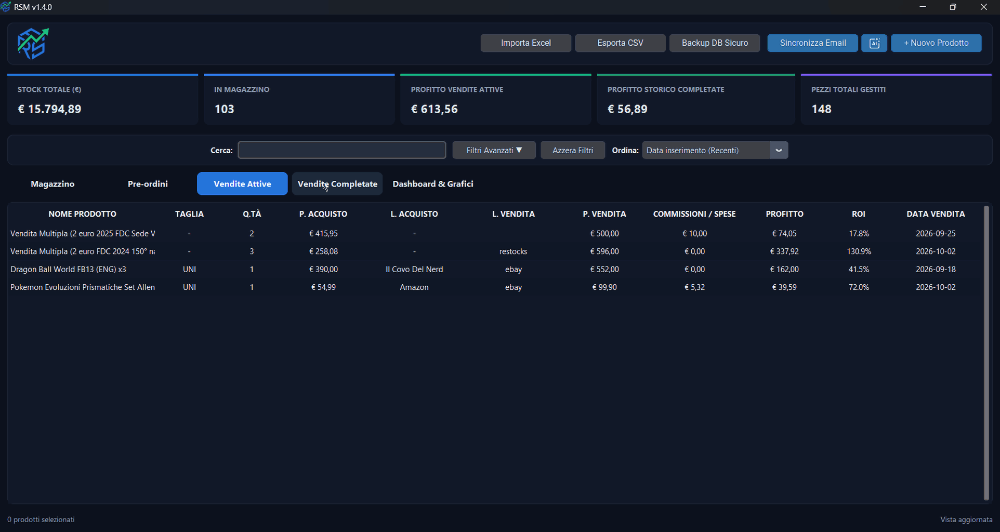

<div align="center">


# RSM

Applicazione desktop moderna ad altissime prestazioni (**Tauri + Rust & Python**) per la gestione di inventario, pre-ordini, vendite attive e storiche, con cruscotto KPI, grafici statistici interattivi, sincronizzazione email, monitoraggio spedizioni in tempo reale (17TRACK) e inserimento intelligente con AI (testuale e vocale).

<p align="center">
  <a href="./README.md"></a>
  <a href="./README.en.md"></a>
</p>

<!-- Badges -->
<p align="center">
  <a href="https://leorusso34.github.io/RSM/"></a>
  
  
  
  
  
  
  
  
  
  
</p>

<p align="center">
  <strong>Sito Web Ufficiale & Showcase Live:</strong> <a href="https://leorusso34.github.io/RSM/">https://leorusso34.github.io/RSM/</a>
</p>

<p align="center">
  
</p>

</div>

---

## Caratteristiche Principali

- **📦 Magazzino & Pre-ordini**: Tracciamento completo di prodotti, taglie, quantità, luoghi di acquisto con tendina a scorrimento rapido e date di rilascio.
- **🏷️ Gestione Vendite & Vendite Multiple**: Conversione rapida, supporto per vendite singole o in blocco (bundle) e drag & drop tra schede.
- **✅ Storico Vendite Completate**: Archiviazione permanente delle vendite concluse con calcolo esatto di ricavi, commissioni, profitto netto e ROI reale.
- **🚚 Monitoraggio Spedizioni 17TRACK**: Tracciamento in tempo reale delle spedizioni integrato nel Side-Drawer di dettaglio prodotto, autoriconoscimento del corriere (BRT, InPost Italy, Poste/SDA, GLS Italy, UPS, DHL), vista compatta delle ultime tappe, tendina espandibile e stato sincronizzato con badge visivo.
- **📦 Creazione Bozze Spedizioni Packlink PRO**: Generazione automatica di bozze su Packlink PRO via REST API v1, autocompilazione dei dati destinatario con Google Gemini AI (`Incolla Rapido`), preset collo (scarpe, busta, custom) e chiave API personale.
- **📊 Dashboard & Grafici Interattivi**: Indicatori KPI in tempo reale, andamento del profitto mensile (€), classifica top prodotti per utile e ripartizione vendite per piattaforma.
- **📬 Sincronizzazione Email Ordini (Gmail + Gemini AI)**: Scansione automatica delle conferme d'ordine da Gmail tramite IMAP e inserimento istantaneo nei Pre-ordini con intelligenza artificiale.
- **🔍 Stima Prezzi di Mercato eBay**: Ricerca automatica e visualizzazione dei prezzi medi e recenti di vendita su eBay tramite API ufficiali.
- **✨ Assistente AI con Riconoscimento Vocale**: Estrazione rapida e strutturata dei prodotti tramite Google Gemini (3.1 Flash Lite) e trascrizione vocale in italiano.
- **🔄 Auto-Updater Integrato**: Verifica automatica della disponibilità di nuove versioni su GitHub Releases con download e installazione assistita tramite proxy Cloudflare protetto.
- **🔑 Configurazione Flessibile via `config.json`**: Possibilità di impostare credenziali personali direttamente dal file esterno `config.json` nella cartella principale (con precedenza assoluta sui dati salvati in app).
- **📁 Import / Export & Backup**:
  - Importazione automatica da fogli **Excel** (`.xlsx`).
  - Backup istantaneo e sicuro del database SQLite locale.
- **⚡ Architettura Zero-Lag & Dark Theme Flat-Minimal**: Interfaccia ultra-reattiva nativa in Tauri (Rust + WebView2), titlebar custom frameless a 28px, side-drawer a scomparsa ancorato a filo, dark theme flat-minimal ad alto contrasto, animazioni fluide a 60 FPS, supporto High-DPI e navigazione istantanea senza latenza.

---

## Configurazione Credenziali (`config.json`)

Tutte le integrazioni esterne (prezzi di mercato eBay, tracking 17TRACK, Google Gemini per inserimento rapido ed Excel, e download degli aggiornamenti da GitHub Releases) sono gestite e protette direttamente sul cloud tramite **Cloudflare Worker**.

Nel file `config.json` nella cartella principale puoi configurare le tue credenziali personali per la sincronizzazione email e la logistica:

```json
{
  "email_sync_address": "tuo_indirizzo@gmail.com",
  "email_sync_app_password": "abcd efgh ijkl mnop",
  "packlink_api_key": "tua_chiave_api_packlink_pro"
}
```

### Dettaglio dei Parametri:
* **`email_sync_address`**: Il tuo indirizzo Gmail da cui scansionare le email di conferma ordine.
* **`email_sync_app_password`**: Password per le App a 16 caratteri generata dal tuo account Google (Sicurezza $\rightarrow$ Verifica in due passaggi $\rightarrow$ Password per le app).
* **`packlink_api_key`**: Chiave API personale generata su Packlink PRO (Impostazioni $\rightarrow$ Packlink PRO API Key) per la creazione automatica delle bozze di spedizione.

> **Nota**: I valori inseriti in `config.json` hanno la **precedenza assoluta** su qualsiasi dato salvato nel database locale. Se modifichi le credenziali all'interno dell'applicazione (tramite le finestre di configurazione), anche `config.json` verrà sincronizzato automaticamente.

---

## Requisiti e Avvio in Sviluppo

```powershell
# 1. Clona il repository
git clone https://github.com/leorusso34/RSM.git
cd RSM

# 2. Installa le dipendenze
python -m pip install -r requirements.txt

# 3. Avvia l'applicazione
python rsm.py
```

---

## Esecuzione dei Test e Controllo Qualità

Il progetto integra una suite di test completa con **Pytest**, collaudo **End-to-End (E2E)** con Chromium headless e controlli automatici di formattazione e linting con **Ruff** (attivi anche nella CI di GitHub Actions):

```powershell
# Installa le dipendenze
python -m pip install -r requirements.txt

# Esegui i test unitari (148 test)
pytest -v

# Esegui la suite E2E a cascata (con player video e report diagnostico su Desktop)
playwright install chromium
python tests/e2e/runner.py

# Esegui il linter del codice
ruff check .
```

---

## Compilazione Eseguibile Standalone

Per compilare l'applicazione in una cartella autonoma (Zero-Lag Engine con Tauri e Rust):

```powershell
python build.py
```

L'eseguibile completo e pronto all'uso verrà generato nella cartella `dist/RSM/`.

---

## Struttura del Progetto

```text
RUSSO STOCK/
├── assets/                       # Icone, logo, grafiche e preview GIF
├── docs/                         # Sito web showcase ufficiale (GitHub Pages)
├── src/                          # Backend Python modulare
│   ├── ai_agent.py               # Integrazione API Gemini
│   ├── config.py                 # Costanti di configurazione e percorsi
│   ├── database.py               # Database SQLite, query e migrazioni
│   ├── ebay_api.py               # Integrazione API eBay per prezzi di mercato
│   ├── email_sync.py             # Sincronizzazione ordini Gmail via IMAP
│   ├── packlink.py               # Creazione bozze di spedizione su Packlink PRO via REST API
│   ├── speech_helper.py          # Riconoscimento vocale
│   ├── tracking.py               # Client tracciamento 17TRACK via Cloudflare Worker
│   ├── types.py                  # Type annotations
│   ├── updater.py                # Auto-updater e controllo release GitHub
│   ├── utils.py                  # Calcoli matematici, formattazioni, I/O Excel
│   └── services/                 # Servizi applicativi
│       └── bridge_server.py      # Micro-server bridge locale ad altissime prestazioni
├── src-tauri/                    # Core nativo Rust Tauri (finestra, IPC e Zero-Lag)
├── web/                          # Frontend moderno Zero-Lag (HTML5, Vanilla JS, CSS3)
│   ├── index.html                # Interfaccia grafica completa
│   ├── app.js                    # Logica frontend reattiva
│   └── styles.css                # Stile dark theme ad alto contrasto
├── tests/                        # Test suite automatica (test_core, test_bridge, test_updater, test_tracking)
├── build.py                      # Script di packaging e compilazione nativa Tauri
├── config.json                   # Configurazione credenziali esterna
├── LICENSE                       # Licenza Open Source MIT
├── README.md                     # Documentazione principale in italiano
├── README.en.md                  # Documentazione completa del progetto in inglese
├── requirements.txt              # Dipendenze Python unificate
└── rsm.py                        # Launcher principale
```

---

## Licenza

Distribuito sotto licenza [MIT](LICENSE).
